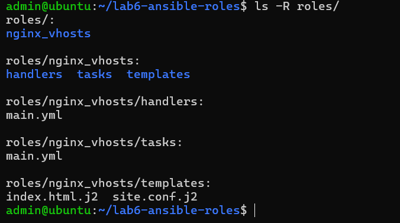
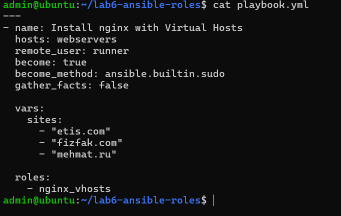
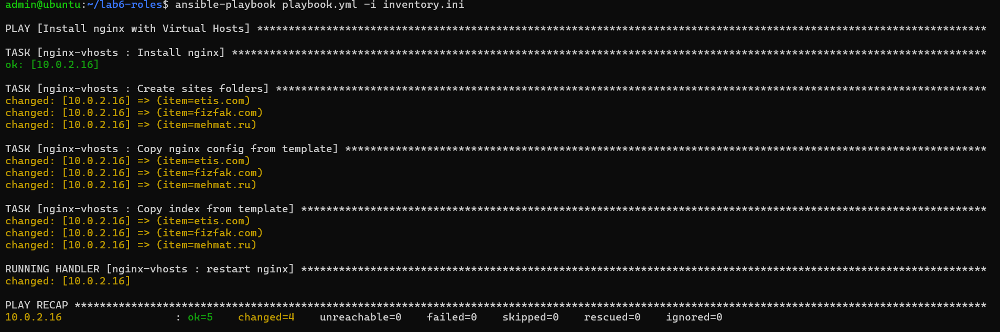
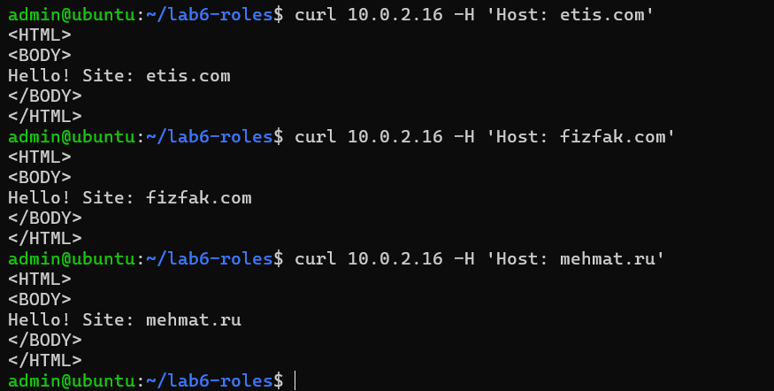
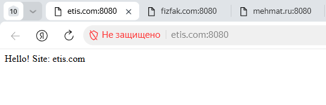
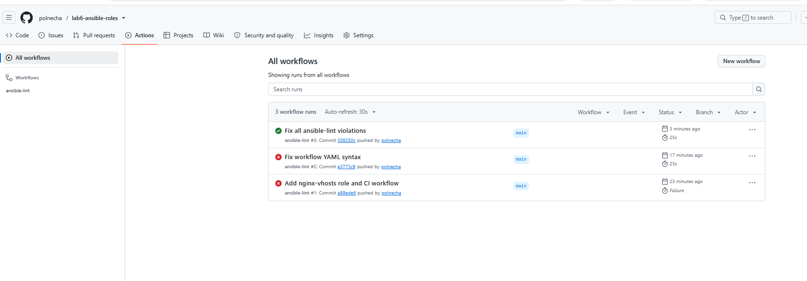

# Лабораторная работа №6: Ansible Roles и CI/CD

**Студент:** Нечаева Полина  
**Группа:** ИТ-3,4  

## Цель работы
1. Изучить структуру и использование Ansible Roles для организации кода.
2. Создать роль для автоматического деплоя веб-сервера Nginx с виртуальными хостами (vhosts).
3. Настроить Continuous Integration (CI) с помощью GitHub Actions для автоматической проверки синтаксиса (ansible-lint).

## Выполненные задачи
- Создана роль `nginx_vhosts` с модульной структурой: задачи (`tasks`), обработчики (`handlers`) и шаблоны Jinja2 (`templates`).
- Роль автоматически устанавливает Nginx, создаёт директории для сайтов, генерирует конфигурационные файлы и стартовые страницы на основе переменной `sites`.
- Виртуальные хосты (`etis.com`, `fizfak.com`, `mehmat.ru`) успешно развёрнуты и проверены через `curl` и браузер.
- Настроен GitHub Actions workflow. Все 7 ошибок `ansible-lint` были найдены и успешно исправлены, пайплайн проходит с зелёной галочкой.

## Структура проекта
- `roles/nginx_vhosts/` — папка с ролью (tasks, handlers, templates).
- `playbook.yml` — главный сценарий, вызывающий роль и передающий переменные.
- `inventory.ini` — файл инвентаризации целевых хостов.
- `.github/workflows/lint.yml` — конфигурация CI-пайплайна.

## Демонстрация результатов

### 1. Структура роли

### 2. Playbook

### 3. Успешный запуск Ansible (с отработкой Handler)

### 4. Проверка виртуальных хостов через curl

### 5. Проверка через браузер (Windows hosts)

### 6. GitHub Actions (CI Pipeline) — все ошибки исправлены

